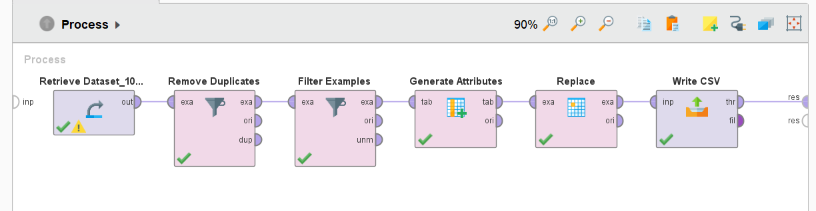
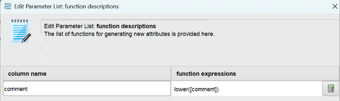
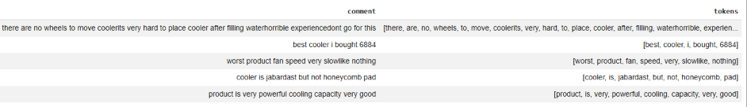
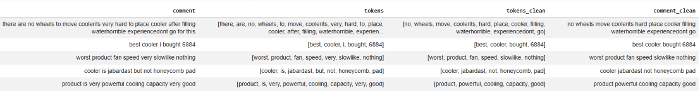
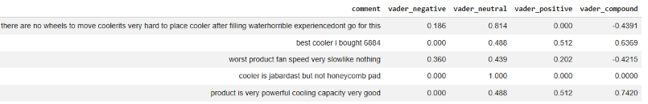
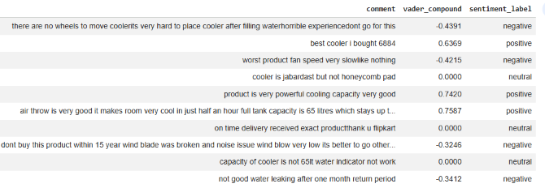
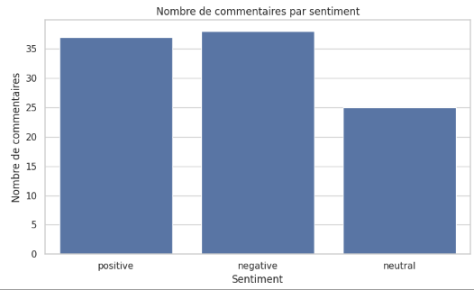
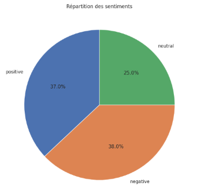
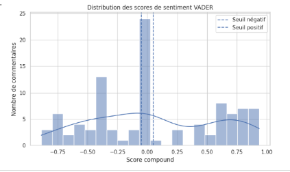

# Analyse des sentiments d'avis clients — Altair AI Studio & Python

Projet de **Text Mining** : analyse des avis clients du produit *MAHARAJA WHITELINE 65 L Desert Air Cooler* vendu sur Flipkart. Le prétraitement initial est réalisé avec **Altair AI Studio**, puis la tokenisation, la suppression des stop words et l'analyse de sentiments sont réalisées avec **Python** (NLTK, VADER).

   

## Objectif

Classer automatiquement 100 avis clients rédigés en anglais en trois catégories — **positive**, **negative** et **neutral** — puis visualiser la répartition des opinions.

## Jeu de données

- **Source :** [Flipkart Product reviews with sentiment Dataset](https://www.kaggle.com/search?q=Flipkart+Product+reviews+with+sentiment+Dataset) (Kaggle)
- **Produit :** MAHARAJA WHITELINE 65 L Desert Air Cooler (White, Grey, Rambo Grey / AC-303)
- **Taille :** 100 commentaires en anglais
- **Colonne exploitée :** `comment` (texte de l'avis)

## Étapes du projet

```
Dataset (CSV) → Altair AI Studio (prétraitement) → CSV → Python (NLTK + VADER) → Visualisations
```

### Étape 1 — Prétraitement avec Altair AI Studio



| Opérateur | Rôle |
|---|---|
| **Retrieve Dataset** | Importer le jeu de données |
| **Remove Duplicates** | Supprimer les commentaires dupliqués |
| **Filter Examples** | Éliminer les lignes avec valeurs manquantes (*no missing attributes*) |
| **Generate Attributes** | Transformer les commentaires en minuscules avec `lower([comment])` |
| **Replace** | Supprimer les signes de ponctuation |
| **Write CSV** | Exporter les données prétraitées vers un fichier CSV |



Le traitement textuel et l'analyse des sentiments se poursuivent ensuite en Python.

### Étape 2 — Tokenisation (NLTK)

Chaque commentaire est découpé en unités appelées *tokens* (généralement des mots), stockées dans la colonne `tokens`.



### Étape 3 — Suppression des stop words

Les mots vides anglais de NLTK sont supprimés. Les **négations** (`no`, `not`, `never`…) sont volontairement conservées, car elles peuvent inverser le sens d'un avis. Résultat dans les colonnes `tokens_clean` et `comment_clean`.



### Étape 4 — Analyse des sentiments avec VADER

**VADER** (*Valence Aware Dictionary and sEntiment Reasoner*) est un outil adapté aux textes courts en anglais. Il calcule plusieurs scores, dont le score global **`compound`**, compris entre -1 et +1.



> Le score VADER est calculé sur le commentaire **original** (`comment`) et non sur `comment_clean`, car VADER exploite la ponctuation, les majuscules et les négations.

### Étape 5 — Création de la colonne `sentiment_label`

| Catégorie | Condition sur le score `compound` |
|---|---|
| **positive** | ≥ 0,05 |
| **negative** | ≤ -0,05 |
| **neutral** | entre -0,05 et 0,05 |



### Étape 6 — Visualisation des résultats

**Diagramme en barres** — nombre de commentaires par sentiment :



**Diagramme circulaire** — proportion de chaque catégorie :



**Histogramme** — distribution des scores VADER :



## Résultats

| Sentiment | Part des commentaires |
|---|---|
| Positive | 37 % |
| Negative | 38 % |
| Neutral | 25 % |

Les avis sont partagés : autant de retours négatifs que positifs, et un quart de commentaires neutres.

## Structure du dépôt

```
├── README.md
├── requirements.txt
├── Text_Mining_Analyse_Sentiments.ipynb
├── Data/
│   ├── Dataset_100Comment.csv      # 100 avis (jeu de données d'entrée)
│   └── Resultat_pretraitement.csv  # export d'Altair AI Studio
└── images/                         # captures utilisées dans ce README
```

## Exécution

1. Installer les dépendances :
   ```bash
   pip install -r requirements.txt
   ```
2. Ouvrir `Text_Mining_Analyse_Sentiments.ipynb` dans **Google Colab** ou Jupyter.
3. Importer `Data/Resultat_pretraitement.csv` quand le notebook le demande (séparateur `;`).
4. Exécuter les cellules : le notebook génère `resultats_analyse_sentiments.csv` avec la colonne `sentiment_label`.

## Limites

VADER repose sur un lexique et des règles linguistiques. Il peut mal interpréter le sarcasme, les formulations complexes ou le vocabulaire propre à un produit. Les résultats sont des estimations automatiques, pas des vérités absolues.

## Auteure

**Hajar Guemili** — Élève-ingénieure, ESI Rabat
[LinkedIn](https://linkedin.com/in/hajar-guemili-b28900434) · [GitHub](https://github.com/Hajar444238)
